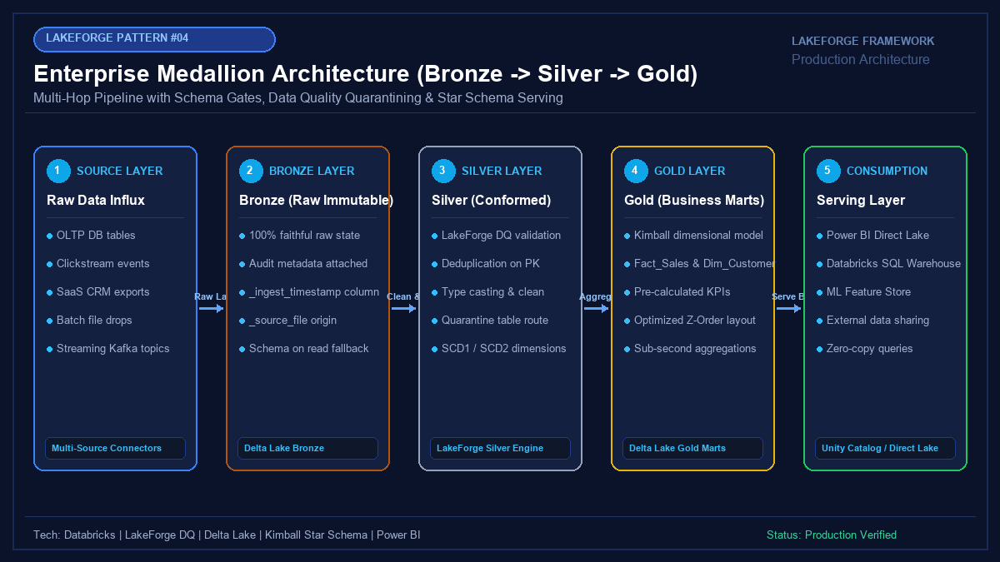

# 🌊 LakeForge Solutions Library

<p align="center">
  
</p>

<p align="center">
  <strong>Production-Grade Data Lakehouse Solutions Built on Databricks, Delta Lake, Azure & Microsoft Fabric</strong>
</p>

<p align="center">
  <a href="https://github.com/jayarampogakula/Lakeforge"></a>
  <a href="https://jayarampogakula.github.io/lakeforge"></a>
  <a href="https://youtube.com/@jayarampogakula"></a>
  <a href="https://github.com/jayarampogakula/lakeforge-examples/stargazers"></a>
  <a href="LICENSE"></a>
</p>

---

> ### 📢 *"People don't buy frameworks. They buy solutions."*
>
> Data teams don't want another theoretical library—they need end-to-end, battle-tested blueprints that solve real enterprise data challenges: high-throughput database replication, metadata control frameworks, zero-downtime SCD Type 2 dimensions, sub-second streaming analytics, and unified governance.
>
> This repository contains **14 complete, end-to-end production solutions** implemented with the **[LakeForge Framework](https://github.com/jayarampogakula/Lakeforge)**.
>
> 📖 **Official Framework Documentation**: [https://jayarampogakula.github.io/lakeforge](https://jayarampogakula.github.io/lakeforge)

---

## 📚 Solutions Catalog

| # | Solution | Core Tech Stack | Business Impact | Link |
| :-: | :--- | :--- | :--- | :-: |
| **01** | **SQL Server to ADLS Gen2** | Azure SQL, PySpark, ADLS Gen2, Key Vault | 16-way parallel JDBC extraction with zero table locking | [Explore Solution →](examples/01_sqlserver_to_adls) |
| **02** | **REST API to Delta Lake** | SaaS REST APIs, OAuth2, Schema Evolution | Resilient ingestion with rate limits, jitter & dynamic schema | [Explore Solution →](examples/02_rest_api_to_delta) |
| **03** | **ADF Metadata Framework** | Azure Data Factory, Azure SQL, Databricks Jobs | 1 parameterized ADF pipeline orchestrating 100+ tables | [Explore Solution →](examples/03_adf_metadata_framework) |
| **04** | **Bronze → Silver → Gold** | Databricks, Medallion Architecture, Kimball | Multi-hop Lakehouse pipeline with quality quarantine gates | [Explore Solution →](examples/04_bronze_silver_gold) |
| **05** | **Automated SCD Type 2** | Delta Lake MERGE, Surrogate Keys, PySpark | Single-pass atomic MERGE tracking historical customer changes | [Explore Solution →](examples/05_scd_type2) |
| **06** | **Incremental Loading** | Watermark State Store, Idempotent MERGE | Stateful watermark tracking with lookback buffer protection | [Explore Solution →](examples/06_incremental_load) |
| **07** | **Real-Time CDC Pipeline** | PostgreSQL, Debezium, Kafka, Delta CDF | Log-based change data capture capturing hard deletes & updates | [Explore Solution →](examples/07_cdc_pipeline) |
| **08** | **Unity Catalog Governance** | Unity Catalog, Entra ID, Row Filters, Masking | 3-level namespace with dynamic column masking & auditing | [Explore Solution →](examples/08_unity_catalog) |
| **09** | **Delta Live Tables (DLT)** | DLT, Auto Loader, Expectations Engine | Declarative ETL DAG with automated data quality expectations | [Explore Solution →](examples/09_delta_live_tables) |
| **10** | **Real-Time Fraud Detection** | Kafka, Structured Streaming, Sliding Windows | Sub-second fraud detection with 10-min sliding windows | [Explore Solution →](examples/10_real_time_pipeline) |
| **11** | **Microsoft Fabric Lakehouse** | Microsoft Fabric, OneLake, V-Order, Spark | Zero-copy OneLake shortcuts and Direct Lake interoperability | [Explore Solution →](examples/11_fabric_pipeline) |
| **12** | **Direct Lake Power BI** | Power BI Direct Lake, Star Schema, TMDL | Sub-second dashboard queries with zero scheduled refreshes | [Explore Solution →](examples/12_powerbi_dashboard) |
| **13** | **Data Quality Trust Engine** | LakeForge Trust Engine, Anomaly Quarantine | Declarative data profiling with quantitative Trust Scores | [Explore Solution →](examples/13_data_quality_trust_engine) |
| **14** | **Delta Lake Optimization** | Liquid Clustering, OPTIMIZE, VACUUM | Solves small file problem; 10x faster query scans | [Explore Solution →](examples/14_delta_lake_optimization) |

---

## 🎯 What's Included in Every Example

Every single solution folder in `examples/` contains a self-contained, enterprise-grade package:

- 📖 **`README.md`**: Business context, anti-patterns, LakeForge solution breakdown, tech stack, and step-by-step setup guide.
- 🏗 **`architecture.png`**: High-resolution, professional architectural diagram visualizing data flow from source to consumption.
- 💻 **Source Code (`source/`)**: Fully functional Python/PySpark/SQL code with enterprise error handling, logging, and LakeForge patterns.
- 📦 **Sample Dataset (`dataset/`)**: Realistic test datasets (CSV, JSON, SQL DDL) ready for local reproduction or cluster deployment.
- 📊 **Expected Output (`expected_output/`)**: Verified query results, metrics summaries, Delta transaction logs, and quarantine records.
- 🎓 **`interview_questions.md`**: Top real-world senior data engineering interview questions with exhaustive, expert answers covering architectural tradeoffs, failure recovery, Spark tuning, and security.
- 🎥 **Video Walkthroughs**: Direct links to video solutions on the [Jayaram Pogakula YouTube Channel](https://youtube.com/@jayarampogakula).

---

## 🚀 Quick Start

### 1. Clone the Repository
```bash
git clone https://github.com/jayarampogakula/lakeforge-examples.git
cd lakeforge-examples
```

### 2. Install Prerequisites
```bash
pip install -r requirements.txt
```

### 3. Run Any Solution Locally
Each solution is designed to run locally in simulation mode using provided datasets or directly on your Databricks cluster:
```bash
# Example 01: SQL Server to ADLS Gen2 Ingestion
python examples/01_sqlserver_to_adls/source/sqlserver_to_adls_pipeline.py

# Example 05: Slowly Changing Dimensions (SCD Type 2)
python examples/05_scd_type2/source/scd2_pipeline.py

# Example 10: Real-Time Streaming & Fraud Detector
python examples/10_real_time_pipeline/source/streaming_fraud_detector.py
```

---

## 🛠 Recommended Prerequisites
- **Python**: 3.9+
- **PySpark**: 3.5.0+
- **Delta Lake**: 3.1.0+
- **Databricks Runtime**: 14.3 LTS+ (for Unity Catalog & DLT examples)
- **Microsoft Fabric**: (for Fabric and Direct Lake Power BI examples)

---

## 👨‍💻 Author & Community

**Jayaram Pogakula**  
*Lead Data Architect & Data Engineering Specialist*  
- 💼 **GitHub**: [@jayarampogakula](https://github.com/jayarampogakula)  
- 📺 **YouTube**: [Subscribe for Video Walkthroughs](https://youtube.com/@jayarampogakula)  
- 🌟 **Main Framework**: [LakeForge Core Repository](https://github.com/jayarampogakula/Lakeforge)

---

## 📄 License
This project is licensed under the MIT License - see the [LICENSE](LICENSE) file for details.
