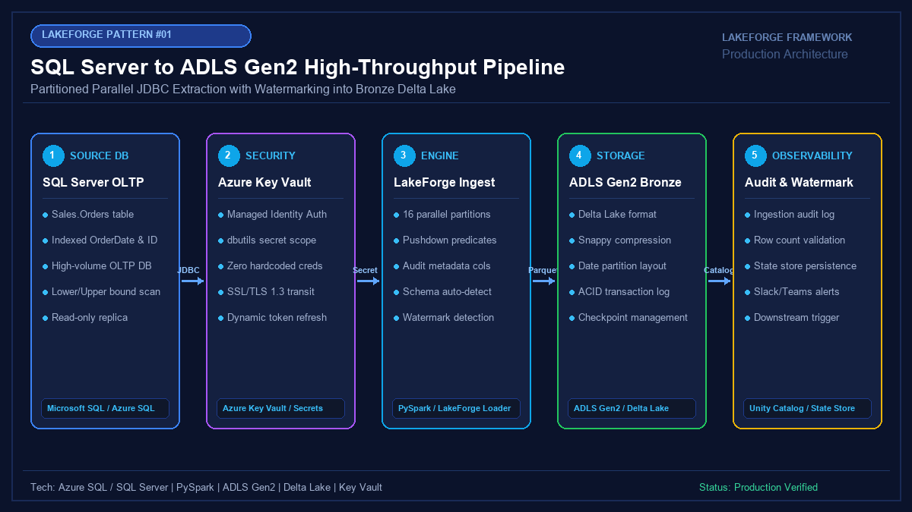

# 01 - Enterprise SQL Server to ADLS Gen2 High-Throughput Pipeline

[](https://youtube.com/@jayarampogakula)
*(Video walkthrough coming soon - subscribe to the channel for release notifications)*

---

## 💡 The Business Problem vs. LakeForge Solution

### The Anti-Pattern (What Teams Usually Do)
- Single-threaded JDBC extraction that causes 8-hour execution bottlenecks on large tables.
- Running heavy unpartitioned `SELECT *` queries against production OLTP primaries, causing lock escalation, table timeouts, and degraded application performance.
- Storing database passwords in configuration files or code repositories.
- Landing raw files as plain CSV/Parquet where job failures leave corrupt partial files.

### The LakeForge Solution
- **Partition-Aware Parallel Ingestion**: Automatically calculates optimal stride partitions (`lowerBound`, `upperBound`, `numPartitions`) to distribute extraction across worker cores.
- **Production Guardrails**: Configured fetch size (`10,000`), read-only replica targeting, and zero table locking.
- **Enterprise Security**: Native integration with Azure Key Vault via Databricks Secret Scopes.
- **Bronze Delta Lake Storage**: Full ACID transaction guarantees, schema validation, and audit metadata injection (`_ingest_timestamp`, `_batch_id`, `_source_system`).

---

## 🏗 Architecture Diagram



### Pipeline Flow
1. **Source System**: SQL Server / Azure SQL OLTP database hosting high-throughput transactional tables (`Sales.Orders`).
2. **Security Tier**: Azure Key Vault supplies rotating credentials dynamically via Databricks Secret Scopes using Managed Identity.
3. **Execution Engine**: LakeForge PySpark Ingestion Driver distributes 4-16 parallel JDBC connections across cluster nodes with column bounds.
4. **Bronze Storage**: Clean landing into ADLS Gen2 in Delta format, partitioned by date.
5. **Observability**: Lineage tracking, row-count validation, and audit logging into Unity Catalog.

---

## 💻 Tech Stack
- **Source Database**: Microsoft SQL Server / Azure SQL Database
- **Orchestration & Compute**: Databricks (PySpark 3.5+) / LakeForge Ingestion Framework
- **Security**: Azure Key Vault & Databricks Secret Scopes
- **Target Lakehouse**: Azure Data Lake Storage Gen2 (ADLS Gen2)
- **Format**: Delta Lake with Snappy Compression
- **Metastore**: Databricks Unity Catalog

---

## 📁 Repository Structure
```
01_sqlserver_to_adls/
├── README.md                          # This solution guide
├── architecture.png                   # High-resolution architectural diagram
├── interview_questions.md             # In-depth Senior DE interview questions & answers
├── source/
│   ├── config.json                    # Connection & ingestion parameters
│   └── sqlserver_to_adls_pipeline.py  # Production PySpark ingestion script
├── dataset/
│   ├── sales_orders_source.sql        # Source SQL DDL and indexing script
│   └── sales_orders_sample.csv        # Mock dataset for local reproduction
└── expected_output/
    ├── adls_bronze_records.json       # Ingested Delta Lake row preview with metadata
    └── pipeline_run_metrics.json      # Ingestion telemetry & execution summary
```

---

## 🚀 How to Run

### Step 1: Clone and Set Up Environment
```bash
git clone https://github.com/jayarampogakula/lakeforge-examples.git
cd lakeforge-examples/examples/01_sqlserver_to_adls
```

### Step 2: Configure Credentials in Azure Key Vault / Databricks
```bash
# Create Databricks secret scope backed by Key Vault
databricks secrets create-scope --scope lakeforge-kv --scope-backend-type AZURE_KEYVAULT ...
```

### Step 3: Run the Pipeline Locally or on Databricks
```bash
python source/sqlserver_to_adls_pipeline.py
```

---

## 📊 Expected Output

### Delta Lake Bronze Record Preview
Each extracted record is automatically enriched with Lakehouse audit lineage:
```json
{
  "OrderID": 100001,
  "CustomerID": "CUST-9012",
  "OrderDate": "2026-11-01",
  "OrderAmount": 1250.00,
  "Currency": "USD",
  "OrderStatus": "COMPLETED",
  "Region": "North America",
  "LastModifiedDateTime": "2026-11-01 10:15:30",
  "_ingest_timestamp": "2026-11-10T08:50:00.123Z",
  "_batch_id": "c7a8b411-9a7e-40cb-a521-12fec90011bb",
  "_source_system": "SQLServer_OLTP",
  "_pipeline_name": "pl_sqlserver_orders_to_bronze"
}
```

### Execution Metrics
```json
{
  "pipeline_name": "pl_sqlserver_orders_to_bronze",
  "execution_status": "SUCCESS",
  "rows_read": 10,
  "rows_written": 10,
  "num_partitions_used": 4,
  "duration_seconds": 3.42
}
```

---

## 🎯 Top Interview Questions
> Read the complete interview preparation guide with in-depth answers in [interview_questions.md](interview_questions.md).

1. **How does Spark's JDBC `partitionColumn` work, and what happens if you choose a skewed column?**
2. **How do you prevent connection pool exhaustion and lock escalation on production OLTP databases during ingestion?**
3. **Why land raw relational data into Delta Lake Bronze instead of raw CSV or Parquet files?**
4. **How do you handle password rotation in Azure Key Vault without breaking running production jobs?**
5. **How do you make the ingestion pipeline idempotent to handle transient network retries without duplicating records?**

---
⭐ **LakeForge Framework**: Production-Ready Data Lakehouse Solutions.
