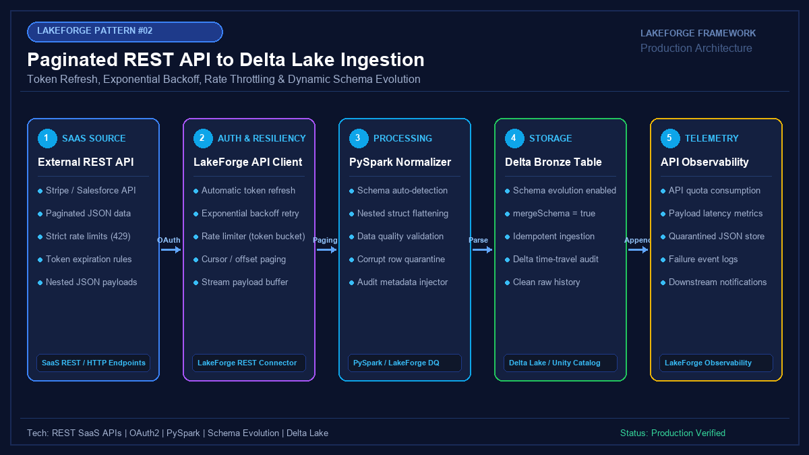

# 02 - Paginated REST API to Delta Lake Ingestion Framework

[](https://youtube.com/@jayarampogakula)
*(Video walkthrough coming soon - subscribe to the channel for release notifications)*

---

## 💡 The Business Problem vs. LakeForge Solution

### The Anti-Pattern
- Firing unthrottled HTTP requests across 100 Spark executor cores, resulting in **HTTP 429 Rate Limit Bans** and crashed jobs.
- Hardcoding fragile page counters that miss or duplicate records during cursor changes.
- Pipeline crashes whenever third-party SaaS vendors introduce new fields or nested JSON schema variants.
- Dropping malformed or corrupted JSON without alerting or lineage tracking.

### The LakeForge Solution
- **Resilient API Engine**: Built-in exponential backoff retry with full jitter and token-bucket rate limiting.
- **Dynamic Pagination**: Full cursor-based and offset-based pagination traversal.
- **Delta Schema Evolution**: Automatic schema adaptation (`mergeSchema = true`) so schema additions seamlessly update tables without downtime.
- **Quarantine Router**: Malformed records are diverted into a designated quarantine Delta table with error reasons preserved.

---

## 🏗 Architecture Diagram



### Pipeline Flow
1. **SaaS API Source**: Stripe / Salesforce endpoints serving paginated JSON records.
2. **LakeForge API Connector**: Manages OAuth2 token refresh, rate limits, and cursor traversal.
3. **PySpark Normalizer**: Parses nested JSON structs, infers schemas, and injects audit columns.
4. **Bronze Delta Lake**: Appends records with ACID transactions, time travel, and schema evolution.
5. **Observability**: Tracks API quota metrics, duration, and quarantined records.

---

## 💻 Tech Stack
- **Source**: SaaS REST Endpoints (Stripe Charges API)
- **Engine**: Python / PySpark 3.5+ / LakeForge REST Connector
- **Format**: Delta Lake with Schema Evolution
- **Catalog**: Unity Catalog Bronze Layer

---

## 📁 Repository Structure
```
02_rest_api_to_delta/
├── README.md                          # Solution documentation
├── architecture.png                   # Architectural diagram
├── interview_questions.md             # Senior DE interview questions & answers
├── source/
│   ├── config.json                    # API & Delta target settings
│   └── rest_api_to_delta_pipeline.py  # Production ingestion pipeline
├── dataset/
│   ├── api_response_page_1.json       # Sample page 1 API response
│   └── api_response_page_2.json       # Sample page 2 with new evolved field ('disputed')
└── expected_output/
    ├── delta_table_preview.json       # Final flattened Delta Lake table output
    └── ingestion_audit_summary.json   # Pipeline execution and schema drift metrics
```

---

## 🚀 How to Run

### Step 1: Run the Pipeline Locally or on Databricks
```bash
python source/rest_api_to_delta_pipeline.py
```

### Step 2: Inspect Ingestion and Schema Evolution
Notice how page 1 and page 2 contain different fields (`disputed`). Delta Lake handles this transparently with `mergeSchema=true` without rewriting historical data!

---

## 📊 Expected Output

### Enriched Delta Table Record
```json
{
  "id": "ch_3MtwxL2eZvKYlo2C1e0z",
  "amount_decimal": 75.00,
  "currency": "eur",
  "customer": "cus_N018243",
  "status": "succeeded",
  "disputed": false,
  "created_timestamp": "2024-01-01T02:00:00.000Z",
  "_ingest_timestamp": "2026-11-10T08:52:00.123Z",
  "_batch_id": "b8f0412a-3901-4476-b63e-10fa8892cc01"
}
```

---

## 🎯 Top Interview Questions
> Read the complete interview preparation guide with in-depth answers in [interview_questions.md](interview_questions.md).

1. **Why should you avoid making REST API calls directly inside PySpark worker tasks?**
2. **How does Delta Lake handle schema evolution when API payloads introduce new fields?**
3. **What is the difference between cursor-based pagination and offset-based pagination in production ETL?**
4. **How do you implement exponential backoff with full jitter to handle HTTP 429 and 503 errors?**
5. **How do you isolate malformed JSON records using Spark's `PERMISSIVE` mode without failing the entire pipeline?**

---
⭐ **LakeForge Framework**: Production-Ready Data Lakehouse Solutions.
