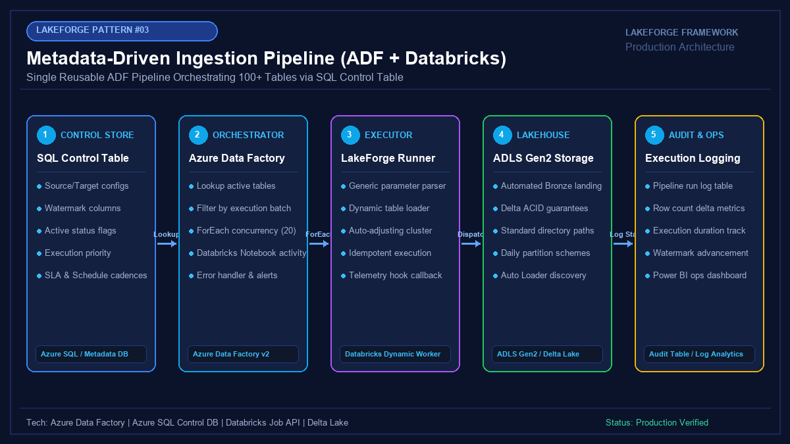

# 03 - Metadata-Driven Ingestion Pipeline (ADF + Databricks)

[](https://youtube.com/@jayarampogakula)
*(Video walkthrough coming soon - subscribe to the channel for release notifications)*

---

## 💡 The Business Problem vs. LakeForge Solution

### The Anti-Pattern
- Creating 200+ separate Azure Data Factory pipelines for 200 source tables.
- Spending 40% of sprint capacity maintaining duplicate pipeline code, copy activities, and linked service configurations.
- Schema changes or lakehouse path renames requiring weeks of manual pipeline editing.
- No central visibility into which tables failed, when watermarks advanced, or table ingestion SLAs.

### The LakeForge Solution
- **Single Master ADF Pipeline**: Reads ingestion parameters dynamically from `etl.ControlTable`.
- **Dynamic Worker Execution**: ADF `ForEach` parallel loop passes parameters directly into a universal LakeForge Databricks worker.
- **Atomic Watermark Advancement**: High watermarks update strictly upon confirmed Delta Lake commit.
- **Central Telemetry Store**: Automated execution logging for real-time auditability and operational dashboards.

---

## 🏗 Architecture Diagram



### Pipeline Flow
1. **Metadata Control Table**: Stores active tables, connection details, watermarks, batch groups, and cadences.
2. **ADF Orchestrator**: Executes a parameterized `Lookup` activity and dynamically dispatches tasks via `ForEach`.
3. **Databricks Generic Worker**: Receives table parameters, compiles dynamic pushdown queries, and extracts data.
4. **ADLS Gen2 Bronze**: Standardized Delta Lake landing with ACID isolation and audit metadata.
5. **Logging Store**: Updates execution duration, row counts, and status in `etl.ExecutionLogs`.

---

## 💻 Tech Stack
- **Orchestration**: Azure Data Factory v2 (Master Pipeline + ForEach Activity)
- **Metadata Database**: Azure SQL Database (`etl.ControlTable` & `etl.ExecutionLogs`)
- **Compute**: Databricks (Autoscaling Pool / PySpark)
- **Target Lakehouse**: ADLS Gen2 / Delta Lake Bronze Layer

---

## 📁 Repository Structure
```
03_adf_metadata_framework/
├── README.md                          # Solution guide
├── architecture.png                   # Architectural diagram
├── interview_questions.md             # Senior DE interview questions & answers
├── source/
│   ├── adf_pipeline_definition.json   # ADF ARM / Pipeline JSON template
│   ├── lakeforge_dynamic_worker.py    # Parameterized Databricks worker notebook
│   └── control_table_ddl.sql          # SQL Server control table DDL and audit schema
├── dataset/
│   └── pipeline_control_table.csv     # 10 production table configurations
└── expected_output/
    ├── pipeline_execution_log.csv     # Granular run logs with execution durations
    └── status_dashboard.md            # Operational summary report
```

---

## 🚀 How to Run

### Step 1: Deploy SQL Control Table
Execute `source/control_table_ddl.sql` in Azure SQL Database.

### Step 2: Import Control Records
Seed `dataset/pipeline_control_table.csv` into `etl.ControlTable`.

### Step 3: Deploy ADF Master Pipeline
Import `source/adf_pipeline_definition.json` into Azure Data Factory and connect your Databricks Linked Service.

---

## 📊 Expected Output

### Pipeline Execution Log
```csv
LogID,PipelineID,SourceTable,ADFRunID,RowsRead,RowsWritten,ExecutionStatus,DurationSeconds
1001,1,Sales.Orders,adf-run-8812-401,15420,15420,SUCCESS,14.2
1002,2,Sales.OrderDetails,adf-run-8812-401,48900,48900,SUCCESS,28.5
1003,3,Sales.Customers,adf-run-8812-401,310,310,SUCCESS,5.1
```

---

## 🎯 Top Interview Questions
> Read the complete interview preparation guide with in-depth answers in [interview_questions.md](interview_questions.md).

1. **What is a metadata-driven ingestion framework, and why is it preferred over hardcoding individual ADF pipelines?**
2. **What are the limits of the ADF `ForEach` activity, and how do you architect around them?**
3. **How do you prevent partial failures in concurrent loops from leaving watermarks in an inconsistent state?**
4. **How do you capture and debug failures within concurrent ADF ForEach iterations?**
5. **How do you manage Databricks cluster startup overhead when ADF triggers dozens of concurrent tasks?**

---
⭐ **LakeForge Framework**: Production-Ready Data Lakehouse Solutions.
