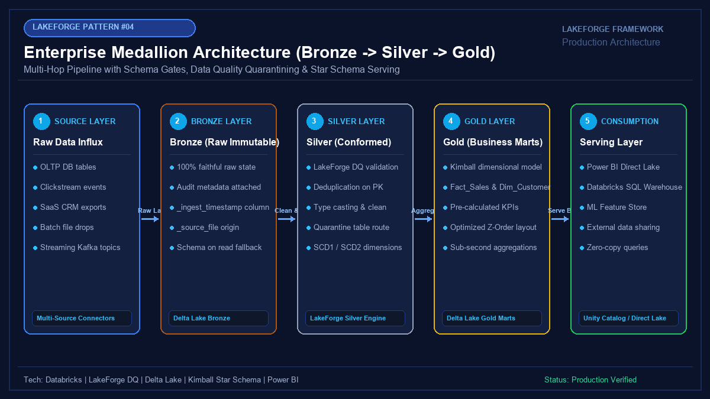

# 04 - Enterprise Medallion Architecture (Bronze -> Silver -> Gold)

[](https://youtube.com/@jayarampogakula)
*(Video walkthrough coming soon - subscribe to the channel for release notifications)*

---

## 💡 The Business Problem vs. LakeForge Solution

### The Anti-Pattern
- Transforming raw, volatile source data directly into final reporting tables ("one-hop ETL").
- When business logic changes, having no historical raw data to reprocess, necessitating expensive and risky source database extracts.
- Dirty or malformed records silently failing the entire pipeline or dropping records with zero audit trace.
- Business analysts querying uncleaned raw tables, resulting in conflicting metric reports across departments.

### The LakeForge Solution
- **Bronze (Raw Immutable)**: Preserves 100% faithful raw payloads with audit lineage (`_ingest_timestamp`, `_source_file`, `_batch_id`).
- **Silver (Conformed & Validated)**: Automated deduplication, type casting, schema conformance, and quarantine routing for bad rows.
- **Gold (Business Marts)**: Dimensional Kimball star schema (Fact & Dim) and high-performance aggregated KPI marts optimized for Power BI Direct Lake.

---

## 🏗 Architecture Diagram



### Pipeline Flow
1. **Multi-Source Influx**: Ingestion of web order JSON streams and relational customer master data.
2. **Bronze Raw Storage**: Append-only Delta Lake preserving immutable history and ingestion metadata.
3. **Silver Cleansing Gate**: Deduplicates records and validates constraints, routing invalid rows to a quarantine table.
4. **Gold Business Marts**: Joins clean Silver orders with conformed customer dimensions into aggregated business KPIs.
5. **Downstream Serving**: Sub-second queries for Power BI Direct Lake, Databricks SQL Warehouses, and ML feature stores.

---

## 💻 Tech Stack
- **Engine**: Databricks / Apache Spark 3.5+
- **Framework**: LakeForge Data Quality & Medallion Pipeline
- **Format**: Delta Lake with ACID Transactions
- **Serving**: Power BI Direct Lake & Unity Catalog

---

## 📁 Repository Structure
```
04_bronze_silver_gold/
├── README.md                          # Solution documentation
├── architecture.png                   # Architectural diagram
├── interview_questions.md             # Senior DE interview questions & answers
├── source/
│   ├── 01_bronze_ingest.py            # Bronze raw ingestion script
│   ├── 02_silver_transform.py         # Silver cleansing & quarantine gate
│   └── 03_gold_marts.py               # Gold dimensional modeling & KPIs
├── dataset/
│   ├── raw_web_orders.json            # Mock orders (with duplicates and anomalies)
│   └── raw_customers.csv              # Customer dimension source
└── expected_output/
    ├── gold_daily_revenue_kpi.csv     # Final aggregated business KPI table
    └── silver_quarantined_orders.json # Rejected bad records with failure reasons
```

---

## 🚀 How to Run

### Step 1: Execute Bronze Ingestion
```bash
python source/01_bronze_ingest.py
```

### Step 2: Execute Silver Cleansing & Quality Gate
```bash
python source/02_silver_transform.py
```

### Step 3: Compute Gold Marts & Business Aggregations
```bash
python source/03_gold_marts.py
```

---

## 📊 Expected Output

### Gold Daily Revenue KPI Mart
```csv
order_date,country,tier,total_orders,total_revenue,avg_order_value
2026-11-01,United States,Enterprise,2,345.00,172.50
2026-11-01,Germany,Mid-Market,1,1400.50,1400.50
2026-11-02,Germany,Mid-Market,1,820.00,820.00
```

### Quarantined Dirty Records
```json
[
  {
    "order_id": "ORD-104",
    "customer_id": "CUST-003",
    "total_amount": -50.00,
    "quarantine_reason": "Invalid Total Amount <= 0"
  },
  {
    "order_id": "ORD-105",
    "customer_id": null,
    "total_amount": 500.00,
    "quarantine_reason": "Missing CustomerID"
  }
]
```

---

## 🎯 Top Interview Questions
> Read the complete interview preparation guide with in-depth answers in [interview_questions.md](interview_questions.md).

1. **Why use a 3-layer Medallion Architecture instead of transforming raw data directly into the reporting Gold layer?**
2. **How do you achieve exactly-once processing when transitioning from Bronze to Silver if the source has duplicates?**
3. **What is the Quarantine Pattern, and why is it superior to dropping records or failing the pipeline?**
4. **Should Gold layer tables follow Kimball dimensional modeling (Star Schema) or wide OBT denormalization?**
5. **What is the optimal partitioning strategy across Bronze, Silver, and Gold layers?**

---
⭐ **LakeForge Framework**: Production-Ready Data Lakehouse Solutions.
