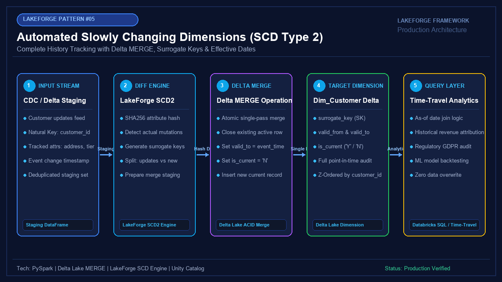

# 05 - Automated Slowly Changing Dimensions (SCD Type 2) Engine

[](https://youtube.com/@jayarampogakula)
*(Video walkthrough coming soon - subscribe to the channel for release notifications)*

---

## 💡 The Business Problem vs. LakeForge Solution

### The Anti-Pattern
- Overwriting dimension records (SCD Type 1) so yesterday's historical revenue is incorrectly attributed to today's customer address or territory.
- Running separate, non-atomic `UPDATE` and `INSERT` statements that cause race conditions, deadlocks, or duplicate active records (`is_current = 'Y'`).
- Generating auto-increment surrogate keys in Spark, triggering expensive cluster-wide data shuffles.
- Creating new versions even when no tracked attributes changed.

### The LakeForge Solution
- **Attribute Hashing (`_attr_hash`)**: Automatically detects real attribute mutations and ignores identical rows.
- **Single-Pass Delta Lake MERGE**: Atomically expires previous current records and inserts new versions in one ACID transaction.
- **Deterministic Surrogate Keys**: High-performance SHA-256 surrogate keys generated across cluster cores with zero cross-node communication.
- **Point-in-Time Historical Auditing**: Full support for as-of historical joins and point-in-time time-travel queries.

---

## 🏗 Architecture Diagram



### Pipeline Flow
1. **CDC Staging Feed**: Daily batch of incoming customer profile modifications.
2. **LakeForge SCD2 Diff Engine**: Calculates SHA-256 attribute hashes and compares against current dimension state.
3. **Atomic MERGE Operation**: Updates `valid_to` and `is_current = 'N'` on matched rows, while appending new active rows (`is_current = 'Y'`).
4. **Target Dim_Customer Table**: Preserves complete historical audit trail with zero overwritten data.
5. **Analytics Serving**: Enables point-in-time revenue attribution and historical ML feature backtesting.

---

## 💻 Tech Stack
- **Engine**: Databricks PySpark 3.5+
- **Format**: Delta Lake with ACID MERGE
- **Hashing**: SHA-256 Attribute & Surrogate Key Generation
- **Target**: Unity Catalog Dimensional Star Schema

---

## 📁 Repository Structure
```
05_scd_type2/
├── README.md                              # Solution documentation
├── architecture.png                       # Architectural diagram
├── interview_questions.md                 # Senior DE interview questions & answers
├── source/
│   ├── scd2_pipeline.py                   # PySpark SCD Type 2 execution engine
│   └── scd2_sql_merge.sql                 # Production Delta Lake MERGE SQL query
├── dataset/
│   ├── customers_initial_snapshot.csv     # Day 1 dimension baseline
│   └── customers_daily_changes_cdc.csv    # Day 2 mutation feed (update, insert, no-op)
└── expected_output/
    ├── dim_customer_scd2_output.csv       # Resulting dimension table with historical versions
    └── history_verification_queries.sql   # SQL audit queries for point-in-time analysis
```

---

## 🚀 How to Run

### Step 1: Execute SCD Type 2 Engine
```bash
python source/scd2_pipeline.py
```

### Step 2: Verify Results
Check the resulting table output in `expected_output/dim_customer_scd2_output.csv` to see how `CUST-1001` has two historical versions, while `CUST-1002` was untouched.

---

## 📊 Expected Output

### Final Dim_Customer Table State
```csv
surrogate_key,customer_id,customer_name,address,city,state,tier,valid_from,valid_to,is_current
sk_1001_v1,CUST-1001,Johnathan Doe,123 Maple St,Seattle,WA,Silver,2026-01-01 00:00:00,2026-11-05 10:00:00,N
sk_1001_v2,CUST-1001,Johnathan Doe,777 Broadway,New York,NY,Gold,2026-11-05 10:00:00,9999-12-31 00:00:00,Y
sk_1002_v1,CUST-1002,Sarah Connor,456 Pine Ave,Los Angeles,CA,Gold,2026-01-01 00:00:00,9999-12-31 00:00:00,Y
sk_1003_v1,CUST-1003,Marcus Vance,789 Oak Rd,Austin,TX,Platinum,2026-01-01 00:00:00,9999-12-31 00:00:00,Y
sk_1004_v1,CUST-1004,Elena Rostova,500 Michigan Ave,Chicago,IL,Silver,2026-11-05 10:00:00,9999-12-31 00:00:00,Y
```

---

## 🎯 Top Interview Questions
> Read the complete interview preparation guide with in-depth answers in [interview_questions.md](interview_questions.md).

1. **What is the difference between SCD Type 1, Type 2, and Type 6, and when is SCD Type 2 required?**
2. **How do you execute an SCD Type 2 update in Delta Lake using a single atomic MERGE statement?**
3. **Why should you avoid auto-incrementing identity keys in PySpark, and what is the LakeForge alternative?**
4. **How do you handle late-arriving or out-of-order records in an SCD Type 2 dimension?**
5. **How do you optimize query performance on a large SCD Type 2 table with hundreds of millions of historical rows?**

---
⭐ **LakeForge Framework**: Production-Ready Data Lakehouse Solutions.
