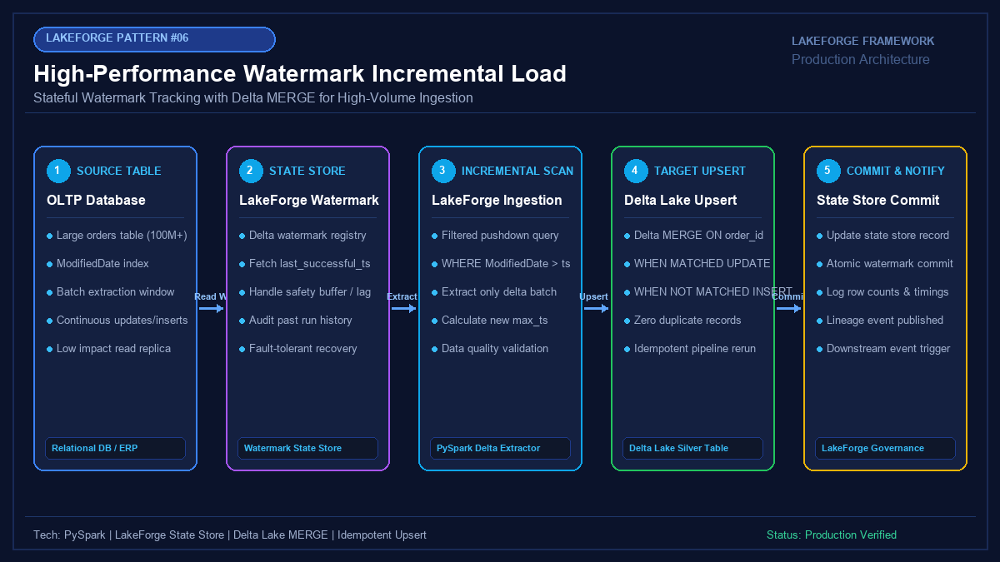

# 06 - High-Performance Watermark-Based Incremental Loading & Idempotent Upsert

[](https://youtube.com/@jayarampogakula)
*(Video walkthrough coming soon - subscribe to the channel for release notifications)*

---

## 💡 The Business Problem vs. LakeForge Solution

### The Anti-Pattern
- Full table scans on 100M+ row tables every single night, causing ballooning cloud compute costs and SLA breaches.
- Watermark extraction that misses in-flight transactions committed milliseconds after query execution.
- Blind appends that generate duplicates every time a source record is updated or a pipeline retries.
- Updating watermark timestamps before the destination write is confirmed, causing unrecoverable data loss upon failure.

### The LakeForge Solution
- **Stateful High Watermark Engine**: Queries only new or modified rows (`WHERE modified_date > last_watermark`).
- **Safety Lookback Buffering**: Incorporates configurable grace windows to eliminate in-flight transaction drop anomalies.
- **Idempotent Delta MERGE**: Seamlessly merges updates and appends new rows with zero duplicate records.
- **Atomic Two-Phase State Commit**: Watermarks advance only after Delta Lake transaction commits are verified.

---

## 🏗 Architecture Diagram



### Pipeline Flow
1. **Source OLTP Table**: Contains continuous orders with modified timestamp indexing.
2. **LakeForge Watermark Store**: Fetches last successfully committed watermark state.
3. **Incremental Pushdown Scan**: Extracts only the delta delta window from source.
4. **Delta Lake Upsert**: Executes high-performance `MERGE ON order_id` with partition pruning.
5. **Atomic State Commit**: Advances high watermark in persistent state store and emits pipeline telemetry.

---

## 💻 Tech Stack
- **Engine**: Databricks PySpark 3.5+
- **Format**: Delta Lake with ACID MERGE
- **State Store**: LakeForge Watermark Registry / Delta Control Table
- **Idempotency**: Delta `WHEN MATCHED UPDATE` / `WHEN NOT MATCHED INSERT`

---

## 📁 Repository Structure
```
06_incremental_load/
├── README.md                              # Solution documentation
├── architecture.png                       # Architectural diagram
├── interview_questions.md                 # Senior DE interview questions & answers
├── source/
│   ├── incremental_loader.py              # PySpark watermark extraction & merge engine
│   └── watermark_store.py                 # Persistent state manager
├── dataset/
│   ├── source_batch_day1.csv              # Initial baseline data batch
│   └── source_batch_day2_incremental.csv  # Day 2 delta batch (updated row + new row + old row)
└── expected_output/
    ├── watermark_state_history.json       # Audit trail of advanced high watermarks
    └── delta_final_records.csv            # Clean, deduplicated final state in Delta Lake
```

---

## 🚀 How to Run

### Step 1: Execute Incremental Pipeline Simulation
```bash
python source/incremental_loader.py
```

### Step 2: Observe Watermark Advancement
Notice how Day 1 processes 3 records and sets watermark to `2026-11-01 14:15:00`.
Day 2 filters out the already processed record, processes 2 records, updates `ORD-5002`, inserts `ORD-5004`, and advances watermark to `2026-11-02 10:45:00`.

---

## 📊 Expected Output

### Watermark State History
```json
[
  {
    "table_identifier": "sales.orders",
    "batch_id": "b11a-initial-load-4902",
    "high_watermark": "2026-11-01 14:15:00",
    "rows_processed": 3,
    "status": "COMMITTED"
  },
  {
    "table_identifier": "sales.orders",
    "batch_id": "c88f-day2-incremental-7124",
    "high_watermark": "2026-11-02 10:45:00",
    "rows_processed": 2,
    "status": "COMMITTED"
  }
]
```

---

## 🎯 Top Interview Questions
> Read the complete interview preparation guide with in-depth answers in [interview_questions.md](interview_questions.md).

1. **What is the "In-Flight Transaction" problem in watermark-based loading, and how do you solve it?**
2. **Why is Delta Lake `MERGE` critical for incremental loading instead of simple append or partition overwrite?**
3. **How do you detect and propagate hard deletes from a source database when doing watermark loading?**
4. **How do you optimize Delta MERGE performance when target tables grow to billions of rows?**
5. **What happens if a pipeline crashes midway through writing incremental data?**

---
⭐ **LakeForge Framework**: Production-Ready Data Lakehouse Solutions.
