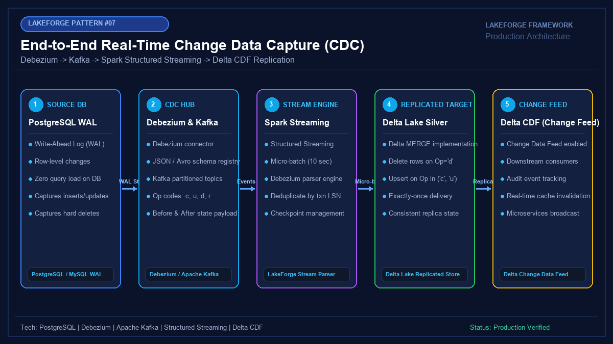

# 07 - End-to-End Change Data Capture (CDC) with Debezium, Kafka & Delta Lake CDF

[](https://youtube.com/@jayarampogakula)
*(Video walkthrough coming soon - subscribe to the channel for release notifications)*

---

## 💡 The Business Problem vs. LakeForge Solution

### The Anti-Pattern
- Polling production databases with expensive `SELECT` queries that slow down transactional users.
- Missing hard deletes because polling queries cannot detect rows that no longer exist in the database.
- Losing intermediate state changes that occur between scheduled batch execution windows.
- Inability to broadcast real-time data mutations to downstream event-driven microservices.

### The LakeForge Solution
- **Log-Based CDC**: Debezium reads Write-Ahead Logs (PostgreSQL WAL / MySQL Binlog) with zero read overhead on operational databases.
- **Spark Structured Streaming Consumer**: Continuously processes micro-batches with micro-second latency.
- **In-Batch Multi-Mutation Deduplication**: Resolves multiple updates to the same key within a single batch before Delta MERGE.
- **Delta Change Data Feed (CDF)**: Captures inserts, updates, and deletes with before/after state for real-time downstream propagation.

---

## 🏗 Architecture Diagram



### Pipeline Flow
1. **Source Database**: PostgreSQL database generating row-level WAL records for orders.
2. **Debezium & Kafka**: Debezium captures log entries and streams JSON/Avro CDC envelopes into partitioned Kafka topics.
3. **Structured Streaming**: Spark micro-batch engine reads Kafka offsets, extracts payloads, and deduplicates by LSN.
4. **Target Replicated Delta Table**: Executes `MERGE` inserting new rows, updating modified rows, and purging deleted rows.
5. **Delta Change Data Feed (CDF)**: Exposes row-level change events to downstream Gold marts and audit consumers.

---

## 💻 Tech Stack
- **Source Database**: PostgreSQL (WAL Level = `logical`)
- **CDC Framework**: Debezium 2.x Connector & Apache Kafka
- **Streaming Compute**: Databricks Spark Structured Streaming
- **Storage**: Delta Lake with Change Data Feed (CDF) enabled

---

## 📁 Repository Structure
```
07_cdc_pipeline/
├── README.md                              # Solution documentation
├── architecture.png                       # Architectural diagram
├── interview_questions.md                 # Senior DE interview questions & answers
├── source/
│   ├── streaming_cdc_consumer.py          # Spark Structured Streaming consumer
│   └── debezium_cdc_parser.py             # Schema parsing and extraction logic
├── dataset/
│   └── debezium_orders_cdc_events.json    # Sample Debezium CDC messages (c, u, d)
└── expected_output/
    ├── replicated_orders_snapshot.csv     # Target replicated table state
    └── delta_cdf_changes_audit.json       # Delta CDF change feed stream
```

---

## 🚀 How to Run

### Step 1: Execute CDC Consumer Simulation
```bash
python source/streaming_cdc_consumer.py
```

### Step 2: Observe Mutation Handling
Notice how:
- `ORD-901` is inserted then updated to `COMPLETED`.
- `ORD-903` is cleanly deleted.
- `ORD-904` is inserted.

---

## 📊 Expected Output

### Replicated Target Snapshot
```csv
order_id,customer_id,order_amount,order_status,order_date,source_lsn
ORD-901,CUST-10,350.0,COMPLETED,2026-11-01,100030
ORD-902,CUST-22,1200.0,PROCESSING,2026-11-01,100020
ORD-904,CUST-33,640.0,COMPLETED,2026-11-02,100050
```

---

## 🎯 Top Interview Questions
> Read the complete interview preparation guide with in-depth answers in [interview_questions.md](interview_questions.md).

1. **What is the architectural difference between query-based CDC and log-based CDC (Debezium/Kafka)?**
2. **What happens if a single Spark Structured Streaming micro-batch contains multiple mutations for the same primary key?**
3. **What is Delta Change Data Feed (CDF), and how does it revolutionize medallion layer propagation?**
4. **How do you achieve end-to-end exactly-once semantics from Kafka to Delta Lake?**
5. **How do you handle schema changes (DDL) originating in the source database when streaming CDC events?**

---
⭐ **LakeForge Framework**: Production-Ready Data Lakehouse Solutions.
