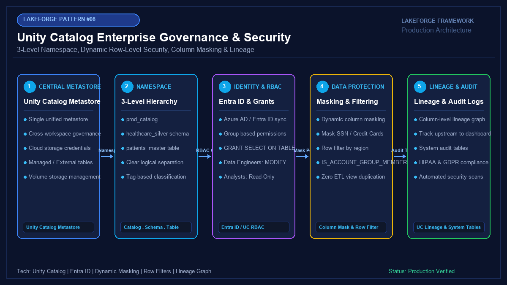

# 08 - Unity Catalog Enterprise Governance, Access Control & Dynamic Masking

[](https://youtube.com/@jayarampogakula)
*(Video walkthrough coming soon - subscribe to the channel for release notifications)*

---

## 💡 The Business Problem vs. LakeForge Solution

### The Anti-Pattern
- Relying on legacy Hive Metastore with no cross-workspace governance or fine-grained RBAC.
- Storing access keys on clusters or mounting storage containers (`dbfs:/mnt/`), exposing all lakehouse data to anyone with cluster access.
- Creating dozens of duplicate SQL views (`v_table_masked_us`, `v_table_eu`) to satisfy privacy laws, leading to "view explosion" and security drift.
- Having no automated audit logs or column-level lineage to prove HIPAA/GDPR regulatory compliance.

### The LakeForge Solution
- **3-Level Namespace**: Standardized `catalog.schema.table` architecture across all enterprise workspaces.
- **Dynamic Column Masking**: PII (SSN, Email) is dynamically masked at query time based on user role (`IS_ACCOUNT_GROUP_MEMBER`).
- **Dynamic Row-Level Security**: Automatically filters rows by geographic operational territory with zero ETL view duplication.
- **Centralized System Audit Tables**: Automated compliance tracking, query access logs, and end-to-end column lineage.

---

## 🏗 Architecture Diagram



### Pipeline Flow
1. **Unity Catalog Metastore**: Account-level central governance hub across all Databricks workspaces.
2. **3-Level Namespace**: Hierarchy (`prod_catalog.healthcare_silver.patients`) isolating production clinical data.
3. **Entra ID Security Groups**: Role-based access grants for Data Engineers, Data Analysts, and Clinical Admins.
4. **Dynamic Policies**: SSN column masking and operational region row-level security.
5. **Observability**: Real-time auditing via `system.access.audit` and column lineage tracking.

---

## 💻 Tech Stack
- **Governance**: Databricks Unity Catalog
- **Identity**: Microsoft Entra ID (Azure AD) Security Groups
- **Security Features**: Dynamic Column Masking, Row-Level Filters, Storage Credentials
- **Format**: Delta Lake with Unity Catalog Managed Tables

---

## 📁 Repository Structure
```
08_unity_catalog/
├── README.md                              # Solution documentation
├── architecture.png                       # Architectural diagram
├── interview_questions.md                 # Senior DE interview questions & answers
├── source/
│   ├── unity_catalog_setup.sql            # Catalog, schema, tables, masking & RBAC DDL
│   ├── dynamic_data_masking.py            # PySpark simulation of masking & row filters
│   └── lineage_governance_check.py        # System tables audit & lineage verification queries
├── dataset/
│   └── healthcare_patients_sample.csv     # Sensitive healthcare patient records
└── expected_output/
    ├── masked_analyst_view.csv            # Restricted analyst query output (Masked SSN, US-only)
    └── admin_unmasked_view.csv            # Unrestricted admin query output (Full access)
```

---

## 🚀 How to Run

### Step 1: Execute Governance Setup DDL
Run `source/unity_catalog_setup.sql` in Databricks SQL or a notebook on a Unity Catalog-enabled cluster.

### Step 2: Run Python Masking Simulation
```bash
python source/dynamic_data_masking.py
```

### Step 3: Verify Column Lineage & System Auditing
Inspect `source/lineage_governance_check.py` to see how system tables provide instant compliance reporting.

---

## 📊 Expected Output

### Masked US Data Analyst View
```csv
patient_id,full_name,ssn,email,diagnosis,region,billing_amount
PT-1001,Alice Johnson,XXX-XX-4321,al***@***.com,Type 2 Diabetes,US,4500.00
PT-1003,Charlie Brown,XXX-XX-2109,ch***@***.com,Asthma,US,850.00
```

### Unrestricted Clinical Admin View
```csv
patient_id,full_name,ssn,email,diagnosis,region,billing_amount
PT-1001,Alice Johnson,987-65-4321,alice.j@example.com,Type 2 Diabetes,US,4500.00
PT-1002,Bob Williams,876-54-3210,bob.w@example.com,Hypertension,EU,1200.50
PT-1003,Charlie Brown,765-43-2109,charlie.b@example.com,Asthma,US,850.00
PT-1004,David Miller,654-32-1098,david.m@example.com,Cardiac Arrhythmia,APAC,9200.00
PT-1005,Eva Schmidt,543-21-0987,eva.s@example.com,Migraine,EU,640.00
```

---

## 🎯 Top Interview Questions
> Read the complete interview preparation guide with in-depth answers in [interview_questions.md](interview_questions.md).

1. **What are the fundamental architectural differences between Hive Metastore and Unity Catalog?**
2. **What is the difference between Managed Tables and External Tables in Unity Catalog?**
3. **How do Dynamic Column Masking and Row-Level Filtering eliminate "View Explosion"?**
4. **How do Storage Credentials and External Locations enforce Least Privilege?**
5. **How do you verify compliance auditing and lineage using Unity Catalog System Tables?**

---
⭐ **LakeForge Framework**: Production-Ready Data Lakehouse Solutions.
