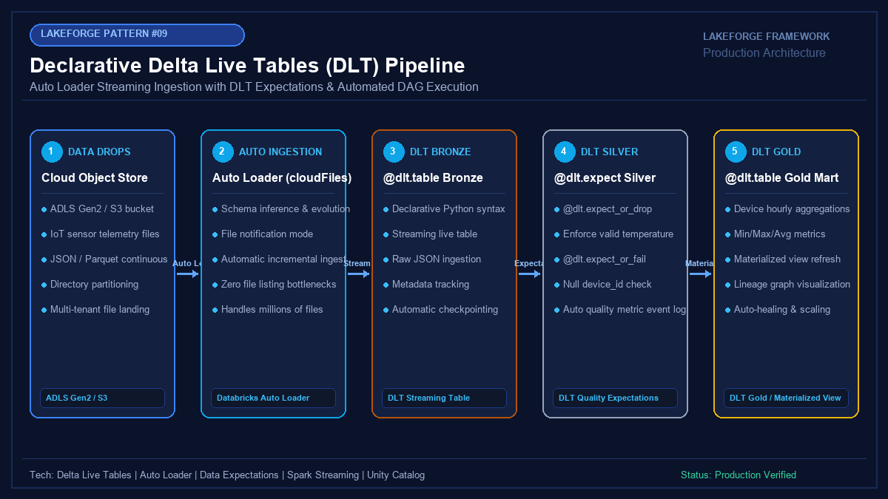

# 09 - Declarative Delta Live Tables (DLT) Pipeline with Auto Loader & Expectations

[](https://youtube.com/@jayarampogakula)
*(Video walkthrough coming soon - subscribe to the channel for release notifications)*

---

## 💡 The Business Problem vs. LakeForge Solution

### The Anti-Pattern
- Writing complex boilerplate code to manage streaming checkpoints, error recovery, and DAG dependency graphs.
- Dropping malformed data silently or letting catastrophic pipeline failures occur at 2 AM due to unexpected nulls.
- Manually sizing clusters that either under-provision (causing lag) or over-provision (wasting budget).
- Having zero visibility into how many records violated business rules across pipeline runs.

### The LakeForge Solution
- **Declarative DLT Framework**: Write simple SQL or Python decorators (`@dlt.table`) and let DLT automatically compile the execution DAG.
- **Auto Loader Streaming Ingestion**: Effortlessly discovers new files in ADLS Gen2/S3 with automatic schema inference and evolution.
- **Built-in Quality Expectations**: Enforces data validation with `@dlt.expect`, `@dlt.expect_or_drop`, and `@dlt.expect_or_fail`.
- **Queryable Event Log**: Full auditability into data volume, throughput, and expectation metrics via Databricks system event logs.

---

## 🏗 Architecture Diagram



### Pipeline Flow
1. **Cloud Storage Landing**: Incoming IoT sensor telemetry JSON drops in ADLS Gen2.
2. **Auto Loader (cloudFiles)**: Streams raw records into Bronze Live Table with zero file listing bottlenecks.
3. **DLT Silver Cleanse**: Validates temperatures and device IDs with `@dlt.expect_or_drop`.
4. **DLT Gold Mart**: Computes materialized hourly aggregates (min/max/avg temperature).
5. **Event Log Telemetry**: Tracks expectation failure counts and pipeline health metrics.

---

## 💻 Tech Stack
- **Engine**: Databricks Delta Live Tables (DLT) Advanced Edition
- **Ingestion**: Databricks Auto Loader (`cloudFiles`)
- **Quality Gates**: DLT Expectations Engine
- **Target**: Unity Catalog Governed Tables

---

## 📁 Repository Structure
```
09_delta_live_tables/
├── README.md                              # Solution documentation
├── architecture.png                       # Architectural diagram
├── interview_questions.md                 # Senior DE interview questions & answers
├── source/
│   ├── dlt_pipeline_notebook.py           # DLT pipeline code with Bronze, Silver, Gold definitions
│   └── dlt_pipeline_settings.json         # Databricks DLT JSON configuration
├── dataset/
│   └── iot_sensor_telemetry.json          # Mock streaming IoT telemetry drops
└── expected_output/
    ├── dlt_expectations_event_log.json    # Event log audit of quality pass/fail rates
    └── gold_sensor_aggregations.csv       # Resulting materialized gold hourly summary
```

---

## 🚀 How to Run

### Step 1: Create DLT Pipeline in Databricks
1. Navigate to **Delta Live Tables** in Databricks.
2. Click **Create Pipeline** and import `source/dlt_pipeline_settings.json`.
3. Set notebook path to `source/dlt_pipeline_notebook.py`.

### Step 2: Start Pipeline
Click **Start** to trigger the DAG execution. DLT will automatically visualize the lineage graph and report real-time expectation metrics.

---

## 📊 Expected Output

### Quality Expectations Audit Log
```json
[
  {
    "dataset": "iot_silver",
    "name": "valid_temperature_range",
    "passed_records": 4,
    "failed_records": 1,
    "action": "DROP"
  },
  {
    "dataset": "iot_silver",
    "name": "valid_battery_level",
    "passed_records": 3,
    "failed_records": 1,
    "action": "TRACK_ONLY"
  }
]
```

### Materialized Gold Aggregations
```csv
device_id,window_start,window_end,avg_temp_c,max_temp_c,min_temp_c,avg_humidity,total_readings
DEV-01,2026-11-01 10:00:00,2026-11-01 11:00:00,23.17,24.0,22.4,44.43,3
DEV-02,2026-11-01 10:00:00,2026-11-01 11:00:00,18.50,18.5,18.5,52.00,1
```

---

## 🎯 Top Interview Questions
> Read the complete interview preparation guide with in-depth answers in [interview_questions.md](interview_questions.md).

1. **What is Delta Live Tables, and how does declarative ETL differ from standard procedural PySpark?**
2. **What is the difference between `@dlt.expect`, `@dlt.expect_or_drop`, and `@dlt.expect_or_fail`?**
3. **What is the difference between a Live Table (`dlt.table`) and a Live View (`dlt.view`)?**
4. **When should you choose Triggered vs Continuous pipeline mode in DLT?**
5. **How do you query and monitor the DLT Event Log for data quality anomalies?**

---
⭐ **LakeForge Framework**: Production-Ready Data Lakehouse Solutions.
