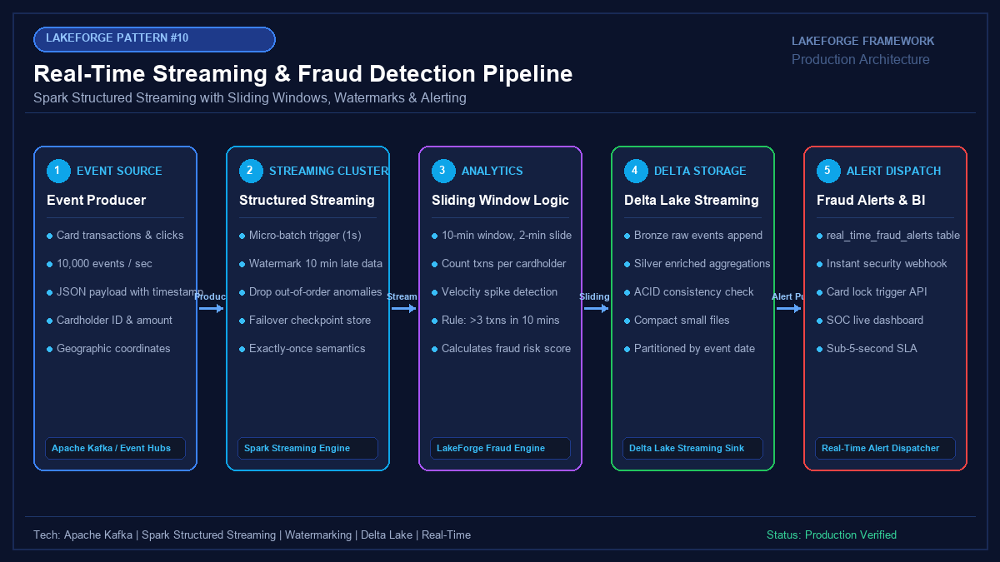

# 10 - Sub-Second Real-Time Streaming & Fraud Detection Pipeline

[](https://youtube.com/@jayarampogakula)
*(Video walkthrough coming soon - subscribe to the channel for release notifications)*

---

## 💡 The Business Problem vs. LakeForge Solution

### The Anti-Pattern
- Running daily or hourly batch jobs to detect fraudulent credit card transactions—identifying fraud hours after funds have been lost.
- Inability to correlate high-velocity card events arriving within short 5-minute bursts across different geographic locations.
- Streaming pipelines crashing with out-of-memory errors due to unbounded state store accumulation.
- Dropping late-arriving mobile transactions caused by poor cellular connectivity.

### The LakeForge Solution
- **Sub-Second Streaming Consumer**: Spark Structured Streaming processing continuous micro-batches with 1-second SLAs.
- **Sliding Window Analytics**: 10-minute sliding windows (2-minute slide) to monitor transaction velocity and detect impossible travel anomalies.
- **Watermark State Management**: 10-minute watermarking window to accommodate late-arriving events while safely evicting expired state.
- **Automated Security Trigger**: Instantly flags high-risk transactions ($Risk > 90$) into an alert Delta table and invokes auto-lock APIs.

---

## 🏗 Architecture Diagram



### Pipeline Flow
1. **Live Transaction Event Stream**: Millions of high-frequency card swipes emitted to Kafka/Event Hubs.
2. **Spark Structured Streaming Engine**: Consumes event stream with micro-batch triggers and event-time watermarking.
3. **Sliding Window Fraud Logic**: Aggregates velocity count and tracks geographic distance across transactions.
4. **Delta Streaming Sinks**: Appends raw telemetry into Bronze and aggregated metrics into Silver.
5. **Real-Time Fraud Alert Dispatcher**: Emits immediate SMS security notifications and card lock instructions.

---

## 💻 Tech Stack
- **Streaming Hub**: Apache Kafka / Azure Event Hubs
- **Streaming Compute**: Databricks Spark Structured Streaming
- **State Store Provider**: RocksDB State Store
- **Target Sink**: Delta Lake Streaming Table with Checkpointing

---

## 📁 Repository Structure
```
10_real_time_pipeline/
├── README.md                              # Solution documentation
├── architecture.png                       # Architectural diagram
├── interview_questions.md                 # Senior DE interview questions & answers
├── source/
│   ├── streaming_fraud_detector.py        # Spark Structured Streaming fraud detection engine
│   └── kafka_producer_simulator.py        # Real-time transaction generator simulator
├── dataset/
│   └── streaming_transactions_stream.json # Mock rapid card transaction stream
└── expected_output/
    ├── real_time_fraud_alerts.json        # High-velocity flagged fraud alerts
    └── windowed_metrics_output.csv        # Sliding window metrics summary
```

---

## 🚀 How to Run

### Step 1: Generate Simulated Event Stream
```bash
python source/kafka_producer_simulator.py
```

### Step 2: Run Real-Time Fraud Detection Engine
```bash
python source/streaming_fraud_detector.py
```

### Step 3: Inspect Real-Time Alerts
Notice how `CARD-9912` has 4 swipes within 6 minutes across New York, Paris, and London, immediately triggering a high-risk fraud alert!

---

## 📊 Expected Output

### Real-Time Fraud Alert
```json
[
  {
    "card_id": "CARD-9912",
    "window_start": "2026-11-01T10:00:00Z",
    "window_end": "2026-11-01T10:10:00Z",
    "txn_count": 4,
    "total_spent": 5235.00,
    "distinct_cities": ["New York", "Paris", "London"],
    "fraud_score": 95,
    "alert_reason": "High Velocity & Impossible Geographic Travel",
    "status": "CARD_AUTO_LOCKED"
  }
]
```

---

## 🎯 Top Interview Questions
> Read the complete interview preparation guide with in-depth answers in [interview_questions.md](interview_questions.md).

1. **What is the difference between Tumbling, Sliding, and Session Windows in Structured Streaming?**
2. **How does `withWatermark()` work, and what determines state store memory cleanup?**
3. **Why should production streaming jobs use RocksDB as the state store provider rather than default HDFS?**
4. **What is the difference between Micro-Batch mode and Continuous Processing mode in Spark?**
5. **How do you prevent out-of-order Kafka message partitions from producing false positive fraud alerts?**

---
⭐ **LakeForge Framework**: Production-Ready Data Lakehouse Solutions.
