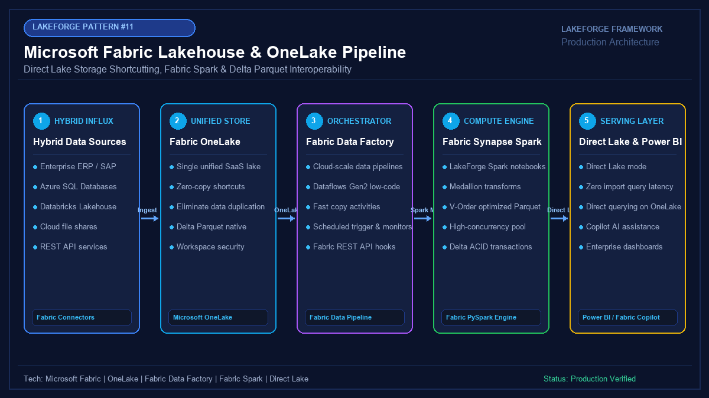

# 11 - Microsoft Fabric Lakehouse & OneLake Pipeline

[](https://youtube.com/@jayarampogakula)
*(Video walkthrough coming soon - subscribe to the channel for release notifications)*

---

## 💡 The Business Problem vs. LakeForge Solution

### The Anti-Pattern
- Creating multiple disjointed copies of the same data across Azure Synapse, Databricks, Snowflake, and Power BI.
- Power BI scheduled refreshes taking hours to import terabytes of data, leaving executive reports stale.
- Complex network architectures, SAS tokens, and IAM role mapping required between independent cloud services.
- High egress network costs moving data across cloud platforms.

### The LakeForge Solution
- **Microsoft OneLake Integration**: Single unified SaaS storage tier ("OneDrive for Data") accessible across all engines.
- **Zero-Copy Shortcuts**: Connect external Databricks ADLS Gen2 or AWS S3 data to Fabric without copying a single byte.
- **V-Order Parquet Optimization**: Orders Parquet data to match Power BI VertiPaq memory layouts, speeding up scans by up to 10x.
- **Direct Lake Mode**: Direct streaming from OneLake Delta tables into Power BI memory with zero import delays or data replication.

---

## 🏗 Architecture Diagram



### Pipeline Flow
1. **Hybrid Data Influx**: Enterprise ERP and General Ledger records ingested via Fabric Data Factory.
2. **OneLake Storage**: Single logical lakehouse hosting unified Delta-Parquet tables with V-Order optimization.
3. **Fabric Synapse Spark**: Executes Medallion transformations, debit/credit reconciliations, and cost-center aggregations.
4. **Direct Lake Semantic Model**: Connects Power BI directly to OneLake Delta tables with zero import refreshes.
5. **Consumption**: Sub-second executive dashboards and Microsoft Copilot AI analytics.

---

## 💻 Tech Stack
- **Platform**: Microsoft Fabric (SaaS Analytics Platform)
- **Unified Storage**: Microsoft OneLake
- **Orchestration**: Fabric Data Factory (Pipelines & Copy Activity)
- **Compute**: Fabric Synapse Spark (PySpark with V-Order)
- **Analytics Mode**: Power BI Direct Lake Mode

---

## 📁 Repository Structure
```
11_fabric_pipeline/
├── README.md                              # Solution documentation
├── architecture.png                       # Architectural diagram
├── interview_questions.md                 # Senior DE interview questions & answers
├── source/
│   ├── fabric_lakehouse_pipeline.py       # Fabric PySpark general ledger pipeline
│   └── fabric_data_pipeline.json          # Fabric Data Factory orchestration pipeline JSON
├── dataset/
│   └── finance_general_ledger.csv         # Enterprise General Ledger mock transactions
└── expected_output/
    ├── fabric_onelake_delta_manifest.json # OneLake Delta manifest & V-Order verification
    └── fabric_kpi_summary.csv             # Final cost center GL KPI summary
```

---

## 🚀 How to Run

### Step 1: Open Microsoft Fabric Workspace
Create a new **Fabric Lakehouse** (e.g., `FinanceLakehouse`) in your Fabric workspace.

### Step 2: Upload Pipeline & Notebook
Import `source/fabric_data_pipeline.json` into Fabric Data Factory and `source/fabric_lakehouse_pipeline.py` into a Fabric Synapse Notebook.

### Step 3: Run General Ledger Reconciliation
```bash
python source/fabric_lakehouse_pipeline.py
```

---

## 📊 Expected Output

### Fabric Cost Center KPI Summary
```csv
cost_center,account_category,total_journal_entries,total_debits,total_credits,net_balance
CC-ENG-CLOUD,EXPENSE,2,6000.50,0.00,-6000.50
CC-MARKETING,EXPENSE,1,4500.00,0.00,-4500.00
CC-SALES-EU,REVENUE,1,0.00,22000.00,22000.00
CC-SALES-US,EXPENSE,1,1200.00,0.00,-1200.00
CC-SALES-US,REVENUE,1,0.00,15000.00,15000.00
```

---

## 🎯 Top Interview Questions
> Read the complete interview preparation guide with in-depth answers in [interview_questions.md](interview_questions.md).

1. **What is Microsoft OneLake, and how does the "One copy of data" philosophy work?**
2. **What are OneLake Shortcuts, and how do they enable zero-copy integration with Databricks or AWS S3?**
3. **What is Microsoft Fabric "V-Order" Parquet optimization, and how does it speed up queries?**
4. **When should an enterprise use a Fabric Lakehouse versus a Fabric Data Warehouse?**
5. **How does Direct Lake mode compare with Import Mode and DirectQuery in Power BI?**

---
⭐ **LakeForge Framework**: Production-Ready Data Lakehouse Solutions.
