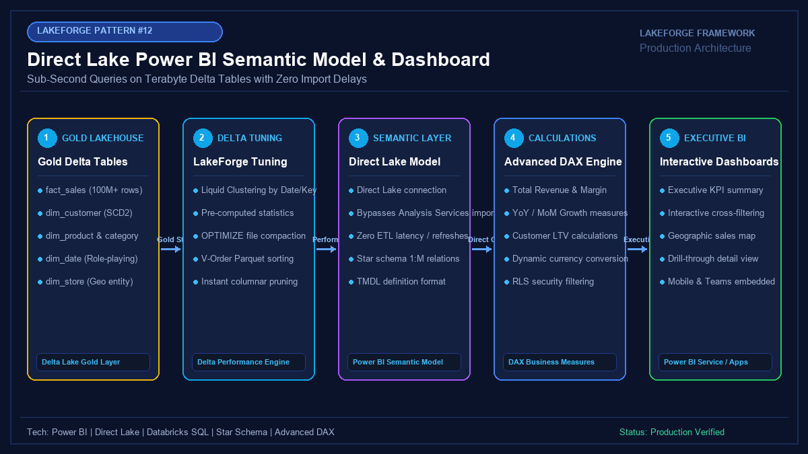

# 12 - Direct Lake Power BI Semantic Model & Executive Dashboard

[](https://youtube.com/@jayarampogakula)
*(Video walkthrough coming soon - subscribe to the channel for release notifications)*

---

## 💡 The Business Problem vs. LakeForge Solution

### The Anti-Pattern
- Scheduled Power BI data refreshes taking 3 hours to import multi-gigabyte datasets, leaving executives with stale data.
- DirectQuery models that take 30+ seconds to render each dashboard visual, overwhelming underlying data warehouse compute.
- Bloated models resulting from storing calculated columns in DAX instead of pushing them into the Lakehouse.
- Storing semantic models in binary `.pbix` files, preventing Git source control, peer reviews, and automated CI/CD deployments.

### The LakeForge Solution
- **Direct Lake Mode**: Delivers the sub-second speed of Import mode with the real-time scale of DirectQuery by memory-mapping Delta Parquet files directly into Analysis Services RAM.
- **Enterprise Star Schema**: Clean $1:\text{Many}$ relationships between Gold Fact (`fact_sales`) and Conformed Dimensions (`dim_customer`, `dim_date`).
- **Production DAX Library**: Tested, production-grade DAX measures for Year-over-Year (YoY) growth, Month-to-Date (MTD), margin percentage, and rolling averages.
- **Git-Native TMDL**: Full Tabular Model Definition Language implementation for enterprise CI/CD and pull-request code reviews.

---

## 🏗 Architecture Diagram



### Pipeline Flow
1. **Gold Delta Tables**: Fact and Dimension tables persisted in Delta format with pre-computed statistics.
2. **Delta Lake Optimization**: Liquid Clustering and V-Order Parquet formatting to enable direct memory-mapping.
3. **Direct Lake Semantic Model**: Analysis Services loads columns directly into VertiPaq memory without import pipelines.
4. **Enterprise DAX Engine**: Calculates complex business metrics (YoY Growth, Gross Margin %, Rolling 7D Averages).
5. **Interactive Executive Dashboards**: Instant cross-filtering, geographic maps, and mobile-responsive drilldowns.

---

## 💻 Tech Stack
- **Serving Layer**: Microsoft Power BI / Fabric Semantic Models
- **Connection Mode**: Direct Lake Mode (Zero scheduled refresh)
- **Modeling**: Kimball Star Schema
- **Code Definition**: TMDL (Tabular Model Definition Language)
- **Data Source**: Databricks / Fabric Gold Delta Lake Tables

---

## 📁 Repository Structure
```
12_powerbi_dashboard/
├── README.md                              # Solution documentation
├── architecture.png                       # Architectural diagram
├── interview_questions.md                 # Senior DE interview questions & answers
├── source/
│   ├── star_schema_gold_views.sql         # SQL DDL for Gold Fact & Dimension tables
│   ├── powerbi_dax_measures.dax           # Production DAX measure repository
│   └── powerbi_model_schema.tmdl          # TMDL semantic model definition
├── dataset/
│   ├── gold_fact_sales.csv                # Sample Fact Sales dataset
│   ├── gold_dim_customer.csv              # Conformed Customer Dimension
│   └── gold_dim_date.csv                  # Official Calendar Date Dimension
└── expected_output/
    ├── dashboard_kpi_metrics.csv          # Expected KPI report results
    └── dax_query_results.json             # Sub-second VertiPaq execution response
```

---

## 🚀 How to Run

### Step 1: Deploy Gold Star Schema
Execute `source/star_schema_gold_views.sql` to build and analyze the Gold Delta tables.

### Step 2: Open Power BI Desktop or Fabric Service
1. Connect via **Direct Lake** to the Gold Delta tables.
2. Verify relationships match `source/powerbi_model_schema.tmdl`.

### Step 3: Add Business DAX Measures
Copy measures from `source/powerbi_dax_measures.dax` into your model to populate executive KPI visuals.

---

## 📊 Expected Output

### Executive KPI Summary
```csv
date,country,total_net_sales,total_cost,gross_profit,gross_margin_pct,active_customers
2026-11-01,United States,1100.00,690.00,410.00,37.27%,1
2026-11-01,Germany,900.00,550.00,350.00,38.89%,1
2026-11-02,United States,1950.00,1200.00,750.00,38.46%,2
TOTAL,All Regions,3950.00,2440.00,1510.00,38.23%,3
```

---

## 🎯 Top Interview Questions
> Read the complete interview preparation guide with in-depth answers in [interview_questions.md](interview_questions.md).

1. **How does Direct Lake mode bypass the Analysis Services import step while retaining VertiPaq speed?**
2. **What causes Direct Lake to fallback to DirectQuery, and how do you prevent it?**
3. **Why is a strict Star Schema mandatory for Power BI performance over flat tables?**
4. **Why must an enterprise Date Table always be marked as an Official Date Table in Power BI?**
5. **What is TMDL (Tabular Model Definition Language), and how does it enable modern CI/CD for Power BI?**

---
⭐ **LakeForge Framework**: Production-Ready Data Lakehouse Solutions.
