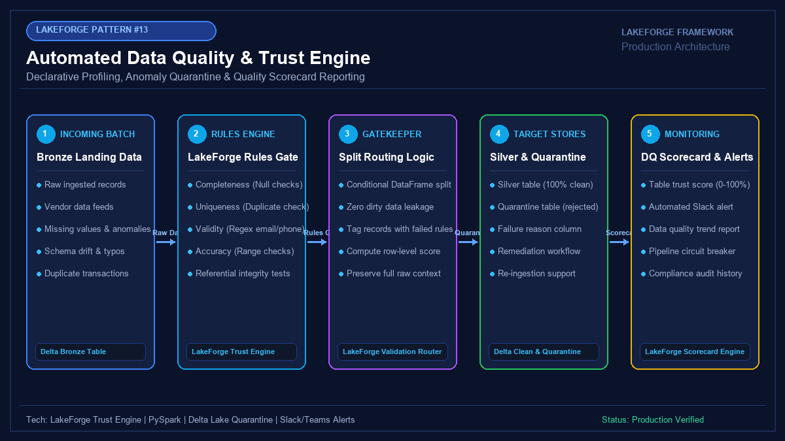

# 13 - Automated Data Quality & Trust Engine

[](https://youtube.com/@jayarampogakula)
*(Video walkthrough coming soon - subscribe to the channel for release notifications)*

---

## 💡 The Business Problem vs. LakeForge Solution

### The Anti-Pattern
- Ingesting dirty, unvalidated data directly into reporting tables and only discovering errors when business stakeholders spot wrong numbers.
- Failing entire 10-million-row pipelines because 3 records had missing emails or invalid status values.
- Having no quantitative measurement of data health or compliance over time.

### The LakeForge Solution
- **Declarative Quality Rules**: Enforce completeness, uniqueness, regex validity, and range checks.
- **Split Quarantine Router**: Good records proceed without interruption; bad records are routed to a dedicated quarantine Delta table with violation details preserved.
- **Table Trust Score (0-100%)**: Quantitative health scorecard per table with automatic circuit breakers and alerting.

---

## 🏗 Architecture Diagram



---

## 💻 Tech Stack
- **Engine**: PySpark 3.5+
- **Framework**: LakeForge Data Trust Engine
- **Target**: Delta Lake Silver & Quarantine Tables

---

## 📁 Repository Structure
```
13_data_quality_trust_engine/
├── README.md                              # Solution documentation
├── architecture.png                       # Architectural diagram
├── interview_questions.md                 # Senior DE interview questions & answers
├── source/
│   └── trust_engine.py                    # LakeForge Data Trust Engine implementation
├── dataset/
│   └── incoming_batch_records.csv         # Sample batch containing valid & corrupt records
└── expected_output/
    ├── trust_scorecard.json               # Computed health metrics and rule breakdown
    └── quarantined_violations.csv         # Quarantined bad records with error explanations
```

---

## 🚀 How to Run
```bash
python source/trust_engine.py
```

---

## 🎯 Top Interview Questions
> Read the complete interview preparation guide with in-depth answers in [interview_questions.md](interview_questions.md).

1. **What is a Data Trust Score, and how does it prevent bad data from reaching executive dashboards?**
2. **What are the primary dimensions of Data Quality according to DAMA-DMBOK?**
3. **How do you design an automated quarantine remediation workflow so business users can correct rejected records?**

---
⭐ **LakeForge Framework**: Production-Ready Data Lakehouse Solutions.
