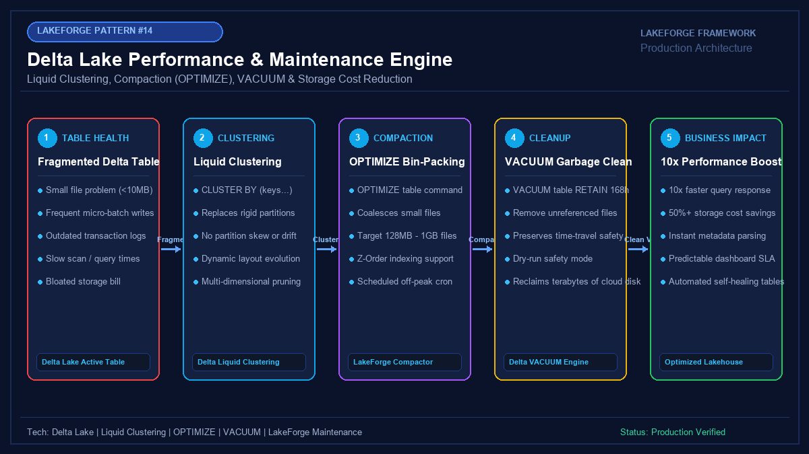

# 14 - Delta Lake Performance & Maintenance Engine

[](https://youtube.com/@jayarampogakula)
*(Video walkthrough coming soon - subscribe to the channel for release notifications)*

---

## 💡 The Business Problem vs. LakeForge Solution

### The Anti-Pattern
- Tables bloated with thousands of tiny 500KB Parquet files from streaming micro-batches, causing queries to drag and driver nodes to freeze.
- High cloud storage costs caused by never vacuuming unreferenced historical file commits.
- Rigid partition schemes causing extreme partition skew and slow query scans.

### The LakeForge Solution
- **Liquid Clustering (`CLUSTER BY`)**: Flexible multi-column clustering with zero directory partitioning bottlenecks.
- **Automated Bin-Packing (`OPTIMIZE`)**: Merges thousands of fragmented files into optimal 128MB - 1GB files for maximum scan throughput.
- **Safe Garbage Collection (`VACUUM`)**: Enforces 7-day safety retention windows to reclaim terabytes of wasted cloud storage without disrupting active readers.

---

## 🏗 Architecture Diagram



---

## 💻 Tech Stack
- **Engine**: Databricks SQL / Delta Engine 3.5+
- **Features**: Liquid Clustering, OPTIMIZE Bin-Packing, VACUUM Lifecycle
- **Target**: High-Concurrency Production Delta Tables

---

## 📁 Repository Structure
```
14_delta_lake_optimization/
├── README.md                              # Solution documentation
├── architecture.png                       # Architectural diagram
├── interview_questions.md                 # Senior DE interview questions & answers
├── source/
│   ├── delta_maintenance_engine.py       # LakeForge Maintenance Engine implementation
│   └── optimization_benchmarks.sql        # Benchmark queries comparing pre/post clustering
├── dataset/
│   └── fragmented_table_manifest.json     # Manifest of 1,540 tiny un-optimized files
└── expected_output/
    └── maintenance_audit_report.json      # Post-optimization metrics (9.4x speedup, 184GB reclaimed)
```

---

## 🚀 How to Run
```bash
python source/delta_maintenance_engine.py
```

---

## 🎯 Top Interview Questions
> Read the complete interview preparation guide with in-depth answers in [interview_questions.md](interview_questions.md).

1. **What is Delta Lake Liquid Clustering, and why does it supersede traditional table partitioning and Z-Ordering?**
2. **What is the Small File Problem in Delta Lake, and how does `OPTIMIZE` resolve it?**
3. **What is the risk of running `VACUUM table RETAIN 0 HOURS`, and why does Databricks block it by default?**

---
⭐ **LakeForge Framework**: Production-Ready Data Lakehouse Solutions.
